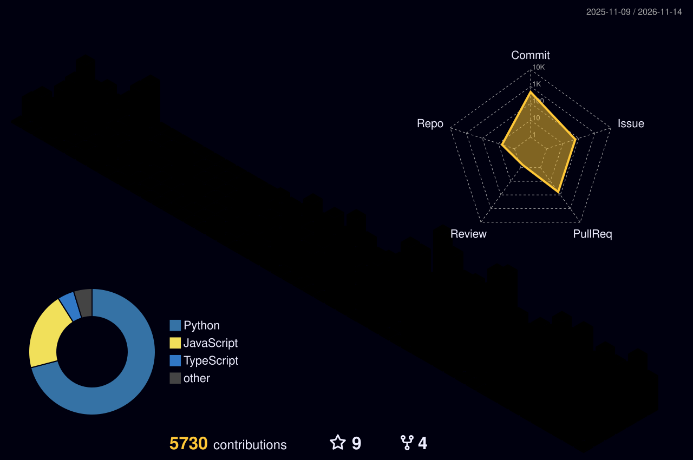

  

  
  
  
  

 

  

## About

Software Engineering student at UnB specializing in conversational AI systems and distributed computing. Currently working as an AI Engineer at BRISA, developing RAG architectures with vector databases and building scalable API solutions with Python frameworks.

**Focus areas:** Retrieval-Augmented Generation, API design, and full-stack development with backend specialization.

## Tech Stack

  
   
  
   
  

## Featured Projects

| Project | What it is | Stack |
| --- | --- | --- |
| [Trokim](https://github.com/moonshinerd/trokim) · [docs](https://moonshinerd.github.io/trokim/) | Open-source personal finance assistant: parses your transactions, tracks budgets and answers questions through a RAG-powered chat | Python · FastAPI · RAG |
| [Flights Watcher](https://github.com/moonshinerd/flights-watcher) | 24/7 flight price watcher on top of Google Flights, with fare history in SQLite and instant Telegram and e-mail alerts when a route hits your target price | Python · SQLite · Telegram |
| [ContrarIA](https://github.com/moonshinerd/ContrarIA) | AI that helps people judge how reliable a piece of information is, without replacing their critical thinking | Python · LLMs |
| [RecomeçoRS](https://github.com/moonshinerd/RSRevive-MaratonaRS) | Hackathon platform to help Rio Grande do Sul flood victims get back on their feet with courses, jobs and volunteer work | JavaScript |
| [Interface PI1](https://github.com/moonshinerd/interface-pi1) | Live dashboard that receives and plots telemetry from water rocket launches | Python · Django |

## GitHub Activity

  

 

  

